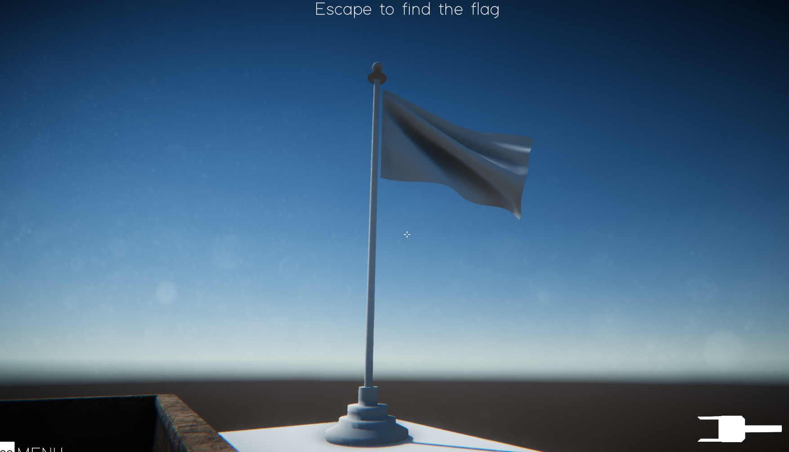
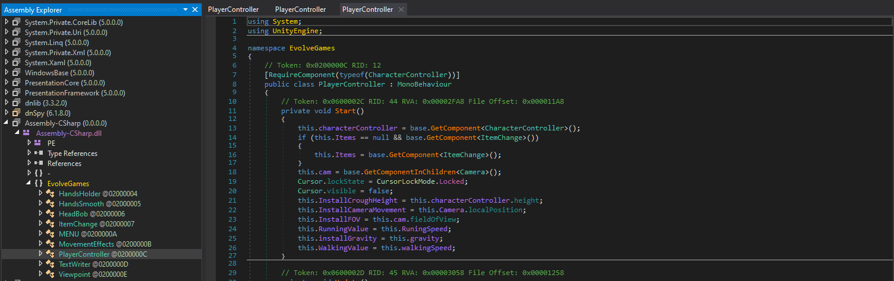

## TL;DR

Diberikan sebuah game yang dibangun dengan .NET Unity, dimana user diharuskan untuk melakukan patching pada logic gamenya untuk melewati invisible wall dan mendapatkan flag.

---

## Challenge Description

> Put this flag in standard academy format before submitting. If the flag was h1_1m_7h3_f14g submit academy{h1_1m_7h3_f14g} to the platform. Windows game, Mac game Use password picoctf to unzip archives.

**Files/Attachment**: `win.zip`
**Target**: -

---

## Recon

- [x] Unzip file zip yang telah di download, dan terdapat file exe `pico.exe` dan folder `pico_Data` pada direktori win setelah dilakukan extracting
- [x] Didalam game, terdapat sebuah bendera besar dimana flag tersimpan disitu, namun kita dihalangi oleh invisible wall dan kita harus melewatinya untuk mendapatkan flag tsb.

---

## Analysis

Saat game dibuka, terlihat instruksi Escape to find the flag, dan juga terlihat tiang bendera diluar dimana kemungkinan besar flag disimpan. Namun, jalan kita kesana terhalan oleh invisible wall, yang mengharuskan kita melakukan manipulasi pada program game untuk mengambil flag tsb.


Pada `pico_Data/Managed` terdapat file `Assembly-CSharp.dll` yang mana pada game skala kecil menengan berisi semua logic dari game dan juga control logic, analysis bisa dimulai dari sini untuk melakukan patching logic dan mendapatkan flag.

Kita bisa menggunakan tools seperti dnSpy untuk melakukan pembongkaran file .dll untuk mengembalikan ke code C# yang bisa dibaca oleh manusia.

---

## Exploitation

### Step 1 — Run The Game

		

Saat hendak meraih flag, pergerakan character terhalang oleh Invisible Wall/Dinding pembatas. Untuk mendapatkan flag, maka kita diharuskan melakukan manipulasi pada program game untuk melewati dinding pembatas tersebut. Untuk melakukan manipulasi program, kita diharuskan untuk melakukan decompile dan reverse engineering untuk menemukan bagian program dimana kita bisa melewati dinding pembatasnya.

---

### Step 2 — Decompile .dll file

Pada game yang dibangun dengan Unity terutama skala kecil dan menengah, logic dari game dan control bisa ditemukan pada file `Assembly-CSharp.dll` , jadi untuk melakukan manipulasi pada alur game, kita harus melakukan decompile file tersebut menggunakan tools seperti `dnSpy` .



Setelah dibongkar, banyak class yang ditampilkan. Namun, kita hanya akan berfokus pada PlayerController karena kita ingin memanipulasi control character agar bisa melewati dinding pembatasnya.

### Step 3 — Find the logic behind

Setelah menggali dan membaca baris kode, saya menemukan baris yang mengatur logika saat player melompat.

```csharp
if (Input.GetButton("Jump") && this.canMove && this.characterController.isGrounded && !this.isClimbing)
{
	this.moveDirection.y = this.jumpSpeed;
}
else
{
	this.moveDirection.y = y;
}
```

Pada intinya, blok kode ini melakukan pengecekan apakah tombol jump ditekan, player tidak dibekukan, sedang menginjak tanah, dan sedang tidak memanjat. Jika semua kondisi terpenuhi, character baru bisa melompat, code ini yang membuat player tidak bisa melakukan double jump untuk melewati invisible wall, karena lompat hanya bisa dilakukan saat player menyentuh tanah.

### Step 4 — Patching logic

Setelah memahami logika lompat dari game tersebut, kita bisa melakukan patching terhadap baris code tersebut dengan membuat kondisi dimana player tetap bisa melompat bahkan ketika sedang tidak menginjak tanah, atau dengan kata lain kita bisa menghapus pengecekan `isGrounded` agar code menjadi seperti ini.

```csharp
if (Input.GetButton("Jump") && this.canMove && !this.isClimbing)
{
	this.moveDirection.y = this.jumpSpeed;
}
else
{
	this.moveDirection.y = y;
}
```

Patch ini, membuat user bisa melakukan lompat berkali kali hingga melewati invisible wall karena tidak ada lagi pengecekan `isGrounded` dan mendapatkan flag. Setelah melakukan patching, compile ulang file `Assembly-CSharp.dll` , kemudian jalankan game lagi dan coba lompat berulang kali.

---

## Obstacles / Dead Ends

- Tidak ada kesusahan sama sekali saat melakukan solving. Hanya saja membutuhkan familiarisasi saat menggunakan tools dnSpy

---

## Flag

```
academy{WELCOME_TO_********}
```

---

## Key Takeaways

- Pada game yang dibangun menggunakan Unity dan masih pada skala kecil hingga menengah, semua logic dari game sering kali akan disimpan di `Assembly-CSharp.dll` yang berada pada direktori `[NamaGame]_Data/Managed/Assembly-CSharp.dll`
- Memahami alur game dalam game hacking sangat penting agar kita bisa tau bagian mana yang harus dimanipulasi untuk mencapai tujuan/exploit yang diinginkan

---

## References

- [Unity game hacking](https://github.com/imadr/Unity-game-hacking)
